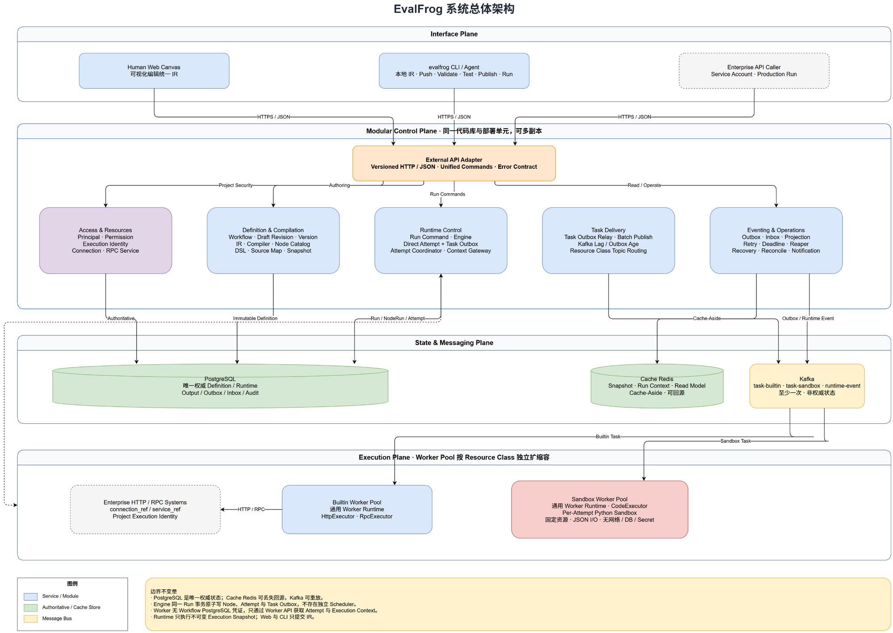

# EvalFrog

> 同时面向 Human Web 与 Agent CLI 的可恢复 Workflow Runtime

EvalFrog 为 Web 用户和 AI Agent 提供统一的工作流创作、发布与执行闭环。两类客户端共同编辑版本化 Canonical JSON IR；Control Plane 完成权限校验、静态分析与确定性编译，并生成不可变 Execution Snapshot；Runtime 只执行 Snapshot，通过 MySQL、Kafka 和 Worker 协同推进状态。

项目当前处于 **M12 Release Candidate 验收阶段**。M0–M11 的作者态、编译、运行时、Worker、HTTP/RPC、Python Sandbox、CLI/Web、故障恢复与可观测性能力已经落地；目标环境容量测试、最终镜像扫描和发布演练仍属于发布门槛，因此尚未标记为 Production Ready。

## 核心链路

```text
Human Web Canvas ─┐
                  ├─ Canonical JSON IR
Agent CLI ────────┘
                         │
                         ▼
              Validate / Compile / Publish
                         │
                         ▼
                Immutable Execution Snapshot
                         │
                         ▼
MySQL Outbox → Kafka → Worker → Runtime Event → Engine
       ▲                                              │
       └────────── MySQL authoritative state ─────────┘
```



可编辑源文件：[EvalFrog_系统架构.drawio](./docs/architecture/EvalFrog_系统架构.drawio)

## 设计重点

### 统一作者态与版本化编译

- Web Canvas 与 Agent CLI 使用同一套 IR、External API、权限模型和错误契约；
- IR 保留稳定 Node/Edge Logical ID，支持人类友好的随机 ID 与 Agent 生成的语义 ID；
- Draft 可以保存结构合法但尚未满足发布条件的中间状态，Validate、Test 和 Publish 执行严格校验；
- Compiler 将 IR 确定性编译为 DSL、Source Map 与 Manifest，Runtime 不直接解释可变 Draft；
- Published Version 与 Execution Snapshot 不可变，Run 在创建时绑定确定的 Snapshot。

IR v2 提供具名 Start 调用参数、具名 End 输出和有序 Branch 条件组。Code 节点由作者声明输出；HTTP/RPC 使用执行契约固定的响应输出。

### 并发编辑一致性与冲突体验

每次保存都会生成不可变 Draft Revision。客户端提交 `expected_revision`，服务端在短事务内锁定 Draft Pointer 并复核 Revision；只有基线仍然有效时，才写入新 Revision 并推进 Pointer，从而防止并发保存发生丢失更新。

Web 在 Revision 冲突后展示画布式三方合并：

- 以共同基线、服务端最新版本和本地编辑结果计算差异；
- 未变化的节点和边自动保留；
- 节点参数发生变化时按整个节点选择；
- 边按起点、终点及 Branch route 判断变化；
- 用户可在合并画布中选择保留或删除元素，并拖动节点确定最终布局；
- 合并结果以最新 Revision 和新的幂等键重新保存，再次冲突时继续保留已选结果。

CLI 获得相同的结构化冲突材料，便于 Agent 或其他工具实现自己的合并策略。

### 短事务与请求幂等

Publish 在事务外完成严格校验和确定性编译，进入事务后锁定并复核 Draft Revision，再原子写入 Execution Snapshot、Published Version、审计记录与 Active Version Pointer。耗时计算不会长期占用数据库连接和行锁。

SaveDraft、Publish、Copy 和 CreateRun 使用独立幂等域。写事务通过唯一键抢占式 INSERT 串行化相同幂等请求；竞争请求读取既有结果并校验 Request Hash：

- 同一请求超时后可以安全重试并复用原结果；
- 同一幂等键携带不同请求体时明确拒绝；
- 并发重试只产生一次业务写入。

### 可恢复的异步执行

Engine 在持有 Run 行锁的短事务内推进状态，并原子写入新产生的 `queued Node + Attempt + Task Outbox`。Task Relay 将 Outbox 发布到 Kafka，Worker 取得执行资格后 ACK，完成结果通过 Runtime Event 唤醒 Engine。

```text
Engine transaction
  → Node/Attempt state + Task Outbox
  → Task Relay publishes Kafka message
  → Worker obtains local slot
  → ClaimAttempt acquires Lease + Fencing token
  → ACK Kafka
  → LoadExecutionContext
  → Execute
  → CompleteAttempt + Runtime Outbox
  → Runtime Event wakes Engine
```

关键可靠性机制：

- Transactional Outbox 保证数据库事实与待发送消息原子落库；
- Inbox 唯一键收敛重复 Runtime Event；
- Run 行锁、State Version CAS 与封闭状态机拒绝非法或过期推进；
- Lease 和 Reaper 恢复崩溃 Worker 持有的 Attempt；
- Fencing Token 拒绝过期 Worker 的迟到 Heartbeat 与 Complete；
- Candidate Output 只有被 Engine 选为 Effective Output 后才能被下游读取；
- Retry 处理业务失败，Recovery 处理基础设施丢失，两者独立计数。

### MySQL、Snapshot L1 与 Kafka

| 组件 | 职责 |
|---|---|
| MySQL 8.4 / InnoDB | 保存 Definition、Snapshot、Run、Node Run、Attempt、Output、Outbox/Inbox、权限与审计，是系统唯一权威状态源 |
| Snapshot L1 | 在每个 Control Plane 进程内缓存不可变、已解析的 Execution Snapshot，具有条目/字节上限、LRU 与并发加载合并 |
| Kafka | 提供 Task 与 Runtime Event 的至少一次传输、积压缓冲和 Worker 横向扩展 |

Execution Context 按 Run 批量读取 Workflow Input 与 Effective Output。Snapshot L1 Miss、淘汰或进程重启会回源 MySQL。SSE 只发送 wake-up，同实例通知与轻量 Run+Node 版本轮询共同触发客户端重新读取 MySQL 派生的 Run View。

### Worker 与执行隔离

- Builtin Worker 执行受管 HTTP/RPC 节点；
- Sandbox Worker 为每个 Python Attempt 创建固定安全规格的 OCI Sandbox；
- Worker 不持有 MySQL 凭据，只通过版本化 Worker API Claim、Heartbeat、Complete 与读取 Execution Context；
- HTTP 只能访问受管 Connection 的相对路径，Secret 在最后一跳注入；
- Python Sandbox 使用只读根文件系统、无网络、无 Host Mount、非 root、资源限制与 Capability Drop；
- Production Profile 要求 `runsc` 与 digest-pinned 镜像，本地与测试 Profile 使用 `runc` 验证执行协议。

## 快速开始

前置条件：Go `1.26+`、Docker、Docker Compose。

Windows：

```powershell
powershell -NoProfile -ExecutionPolicy Bypass -File .\scripts\dev.ps1
```

Linux/macOS：

```bash
./scripts/dev.sh
```

默认入口：

| 服务 | 地址 |
|---|---|
| Web Canvas | `http://localhost:3000` |
| Control Plane | `http://localhost:8080` |
| Builtin Worker Health | `http://localhost:8081/health/ready` |
| Sandbox Worker Health | `http://localhost:8082/health/ready` |
| MySQL | `localhost:13306` |
| Kafka | `localhost:29092` |

停止本地服务并保留数据：

```powershell
powershell -NoProfile -ExecutionPolicy Bypass -File .\scripts\down.ps1
```

开发环境需要准备 Project、Principal、Bearer Token 和相应权限；受管 HTTP/RPC 节点还需要 Connection 或 Service Catalog 数据。

## CLI

```text
evalfrog workflow create|pull|copy|builder
evalfrog draft push|validate
evalfrog publish
evalfrog run test|create|status|diagnose|cancel|replay
evalfrog node-type list
evalfrog connection list
evalfrog config validate
evalfrog doctor
```

详细参数与 Agent 工作流见 [Agent CLI 手册](./docs/agent/EvalFrog_Agent_CLI_手册.md) 和 [EvalFrog Workflow Skill](./skills/evalfrog-workflow/SKILL.md)。

## 验证

基础质量门槛：

```bash
go test ./...
go test -race ./...
go vet ./...
go build ./cmd/...
```

Web：

```bash
cd web
npm test
npm run test:browser
npm run build
```

真实 MySQL、Kafka 与 Sandbox Integration：

```bash
go test -tags=integration ./tests/integration
```

架构测试会拒绝 Domain 导入 Adapter、Compiler 访问基础设施、Worker 直接连接 MySQL，以及新增模糊的 `common/utils/service/pkg` 边界。

## 代码地图

```text
cmd/
  evalfrog/             CLI
  control-plane/        External API、Engine、Relay、Recovery
  worker-builtin/       HTTP/RPC Worker
  worker-sandbox/       Python Sandbox Worker

internal/
  ir/                   IR、Parser、Validator、Canonical JSON
  catalog/              Node Catalog
  compiler/             IR → DSL / Source Map / Snapshot
  definition/           Draft、Publish、Version 生命周期
  runtime/engine/       Run/Node 状态机与图推进
  runtime/attempt/      Claim、Lease、Fencing、Complete
  runtime/context/      Execution Context 与 Snapshot L1
  eventing/             Outbox Relay、Kafka Consumer、Inbox
  worker/               Worker Runtime 与 Executor
  recovery/             Retry、Deadline、Reaper、Reconciler
  projection/           Run Read Model 与 SSE wake-up
  adapters/             MySQL、Kafka、HTTP、Sandbox Adapter

contracts/              IR、DSL、Source Map、OpenAPI、Message Schema
migrations/             MySQL Schema
web/                    Human Web Canvas
tests/integration/      真实依赖与跨组件验证
deployments/            本地与发布部署配置
```

## 当前边界

- M12 目标环境容量与安全验收尚未完成，项目尚未标记为 Production Ready；
- 客户端不能上传 DSL 或覆盖 Source Map；
- 第一阶段节点包含 Start、End、Branch、HTTP、RPC 与 Python Code；
- 不支持 Loop、显式 Join、Human Approval、SQL、LLM、Agent 或 Plugin Node；
- Kafka 提供至少一次传输，不宣称 Exactly-Once；
- Production Profile 的镜像扫描、网络策略与容量指标必须通过发布验收手册中的门槛。

## 深入阅读

1. [项目准则](./项目准则.md)：项目边界、验收与提交规则；
2. [核心架构决策](./docs/architecture/decisions/00_核心架构决策基线.md)：领域模型与不可变量；
3. [分布式执行边界](./docs/architecture/decisions/01_分布式调度与Worker执行边界.md)：Engine、Kafka 与 Worker 边界；
4. [IR 编辑态结构](./docs/architecture/decisions/03_IR编辑态结构基线.md)：Draft、Revision、Catalog 与作者态契约；
5. [Control Graph 语义](./docs/architecture/decisions/04_ControlGraph语义基线.md)：Branch、引用安全与静态分析；
6. [学习文档](./docs/learning/学习文档.md)：关键取舍、故障场景与面试复习；
7. [实施计划与验收标准](./docs/plans/项目实施计划与验收标准.md)：M0–M12 的交付和证据门槛；
8. [故障恢复与 DLQ 手册](./docs/operations/故障恢复与DLQ运行手册.md)；
9. [发布与容量验收手册](./docs/operations/发布与容量验收手册.md)。
