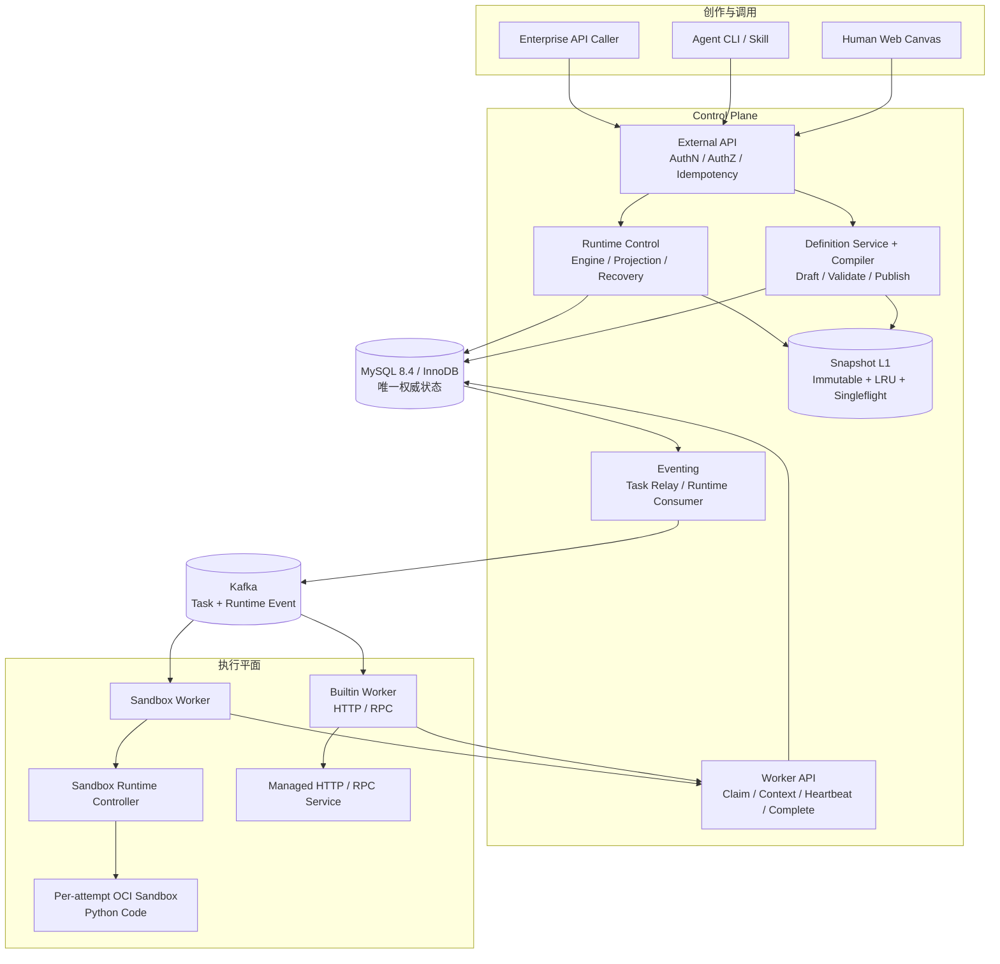

# EvalFrog

> 面向 Human Web 与 Agent CLI 的工作流创作、编译与可靠执行平台

EvalFrog 用同一套 **Canonical JSON IR** 连接可视化画布与 Agent CLI：人和 Agent 可以共同编辑、校验、发布和运行工作流，而运行时只执行已经编译完成的不可变 Snapshot。项目聚焦工作流平台中最值得深入学习的工程问题——并发编辑、确定性编译、分布式可靠执行、幂等与故障恢复，以及不可信代码的沙箱隔离。

[快速开始](#快速开始) · [核心能力](#核心能力) · [系统架构](#系统架构) · [学习路线](#学习路线) · [文档导航](#文档导航)

## 为什么是 EvalFrog

很多工作流示例止步于“把节点连起来并依次执行”。EvalFrog 进一步回答一套真实平台必须面对的问题：

- Web 用户与 Agent 同时修改一个工作流时，如何既防止丢失更新，又不让冲突变成手工修改 JSON；
- 作者态工作流如何经过静态分析和确定性编译，成为可审计、可复现的运行时输入；
- 数据库事务与 Kafka 至少一次投递并存时，如何避免任务丢失、重复推进和过期 Worker 回写；
- HTTP、RPC 与 Python Code 等不同执行形态，如何共享生命周期协议，同时保持凭据和运行环境隔离。

因此，它既是一个可运行的工作流系统，也是一个适合研究工作流引擎、分布式一致性和平台工程的代码库。

## 核心能力

| 能力 | EvalFrog 的实现 |
|---|---|
| 双端创作 | Human Web Canvas 与 Agent CLI 共享 IR、API、权限和错误契约 |
| 可视化建模 | 支持节点拖拽、端口连线、增删节点/边、参数定义、上游输出引用和 Branch 条件 |
| 并发编辑 | Draft Revision 乐观并发控制；冲突后在画布中进行节点/边级三方合并 |
| 编译发布 | 对 IR 做静态分析，并确定性生成 DSL、Source Map 与不可变 Execution Snapshot |
| 可靠执行 | Transactional Outbox、Inbox 去重、Lease、Fencing Token、Retry 与 Recovery |
| 执行隔离 | Builtin Worker 执行受管 HTTP/RPC；Sandbox Worker 隔离执行 Python Code |
| 可观测运行 | Run/Node/Attempt 状态、结构化诊断、SSE 唤醒和审计记录 |

当前提供 `Start`、`End`、`Branch`、`HTTP`、`RPC` 与 `Python Code` 节点。Start 输入是调用工作流时传入的参数；End 与中间节点可以声明具名输出；下游输入可以引用任意可达前序节点的输出。

## 快速开始

### 1. 准备环境

- Docker 与 Docker Compose
- Go `1.26+`（仅在本地运行 Go 命令或 CLI 时需要）

```bash
git clone https://github.com/uu999/evalfrog.git
cd evalfrog
```

### 2. 启动本地环境

Windows：

```powershell
powershell -NoProfile -ExecutionPolicy Bypass -File .\scripts\dev.ps1
```

Linux / macOS：

```bash
./scripts/dev.sh
```

启动脚本会构建 Sandbox 镜像、拉起 MySQL、Kafka、Control Plane、Web 与两类 Worker，并执行连通性诊断。

| 入口 | 地址 |
|---|---|
| Web Canvas | `http://localhost:3000` |
| Control Plane API | `http://localhost:8080` |
| Builtin Worker Health | `http://localhost:8081/health/ready` |
| Sandbox Worker Health | `http://localhost:8082/health/ready` |
| MySQL | `localhost:13306` |
| Kafka | `localhost:29092` |

进入画布前需要准备开发用的 Project、Principal、Bearer Token 及对应权限；HTTP/RPC 节点还需要 Connection 或 Service Catalog 数据。CLI 的完整连接方式与创作流程见 [Agent CLI 手册](./docs/agent/EvalFrog_Agent_CLI_手册.md)。

停止服务并保留本地数据：

```powershell
powershell -NoProfile -ExecutionPolicy Bypass -File .\scripts\down.ps1
```

## 系统架构



可编辑版本：[EvalFrog 系统架构.drawio](./docs/architecture/EvalFrog_系统架构.drawio)

架构中三类基础设施职责互不混淆：

- **MySQL** 保存 Definition、Snapshot、Run、Node Run、Attempt、Output、Outbox/Inbox、权限与审计，是唯一权威状态源；
- **Kafka** 承担 Task 与 Runtime Event 的至少一次传输、积压缓冲和 Worker 横向扩展，不保存权威业务状态；
- **Snapshot L1** 是每个 Control Plane 进程内的不可变解析结果缓存，Miss、淘汰或进程重启都回源 MySQL。

Worker 不持有工作流数据库凭据，只通过 Worker API 获取 Attempt 和 Execution Context。Sandbox Runtime Controller 独占容器运行时权限，并为每次 Python Attempt 创建受限 OCI Sandbox。

## 一次工作流如何运行

```text
Web / CLI 编辑 Canonical IR
  → 保存 Draft Revision
  → Validate / Test / Publish
  → Compiler 生成不可变 Execution Snapshot
  → CreateRun 绑定确定版本
  → Engine 原子写 Node、Attempt 与 Task Outbox
  → Task Relay 发布 Kafka
  → Worker Claim + Lease + Fencing 后执行
  → CompleteAttempt 写结果与 Runtime Outbox
  → Runtime Event 唤醒 Engine 推进后续节点
```

这条链路把作者态与运行态明确分开：Draft 可以持续变化，已发布 Snapshot 不可变；Kafka 消息可以重复，MySQL 中的状态机、幂等键与 Fencing Token 负责收敛最终结果。

## 并发编辑体验

保存 Draft 时，客户端携带预期 Revision，服务端在短事务内复核并推进版本，防止并发保存互相覆盖。发生冲突后，Web 不要求用户重新编辑，也不暴露 Graph JSON，而是在原画布上展示共同基线、服务端最新版本与本地结果的三方差异：

- 双方均未修改的元素自动合并；
- 参数发生变化的节点按整个节点选择保留或删除；
- 边按起点、终点与 Branch route 识别变化；
- 冲突元素使用来源标记，用户可以选择、删除并重新拖拽布局；
- 合并结果基于最新 Revision 再次保存，仍冲突时保留已完成的选择继续合并。

保存、发布、复制与创建运行分别使用独立幂等域。唯一键抢占式 INSERT 和 Request Hash 校验让超时请求可以安全重试，同时拒绝同一幂等键承载不同请求。

## CLI 与 Agent

```text
evalfrog workflow create|pull|copy|builder
evalfrog draft push|validate
evalfrog publish
evalfrog run test|create|status|diagnose|cancel|replay
evalfrog node-type list
evalfrog connection list
evalfrog config validate
evalfrog doctor
```

Agent 可以通过 [EvalFrog Workflow Skill](./skills/evalfrog-workflow/SKILL.md) 获取面向任务的操作约束；详细参数、环境变量与端到端示例见 [Agent CLI 手册](./docs/agent/EvalFrog_Agent_CLI_手册.md)。

## 学习路线

如果你希望通过源码理解一个工作流平台，可以按问题而不是目录顺序阅读：

1. **工作流如何被表达和编译**
   从 [`internal/ir`](./internal/ir)、[`internal/catalog`](./internal/catalog) 和 [`internal/compiler`](./internal/compiler) 开始，再对照 [`contracts`](./contracts) 中的 IR、DSL、Source Map 与 API 契约。
2. **并发编辑如何兼顾一致性和体验**
   阅读 [`internal/definition`](./internal/definition)、[`definition_store.go`](./internal/adapters/mysql/definition_store.go)、[`merge.js`](./web/src/merge.js) 与 [`graph-editor.js`](./web/src/graph-editor.js)。
3. **异步运行时如何可靠推进**
   阅读 [`internal/runtime/engine`](./internal/runtime/engine)、[`internal/runtime/attempt`](./internal/runtime/attempt) 与 [`internal/eventing`](./internal/eventing)，关注事务边界、Outbox、Lease 和 Fencing。
4. **不可信代码如何隔离执行**
   阅读 [`internal/worker`](./internal/worker)、[`internal/adapters/sandbox`](./internal/adapters/sandbox) 与 [`deployments/sandbox`](./deployments/sandbox)。

完整的设计取舍、故障场景和面试复习材料收录在 [学习文档](./docs/learning/学习文档.md)。

## 项目边界

EvalFrog 当前适合作为工作流平台源码、分布式系统实践和本地开发环境使用；仓库没有把“能在本地运行”等同于已经满足生产发布门槛。

- Runtime 不接受客户端上传 DSL，也不解释可变 Draft；
- Kafka 提供至少一次传输，不宣称 Exactly-Once；
- 暂不提供 Loop、显式 Join、Human Approval、SQL、LLM、Agent 或 Plugin Node；
- 生产部署仍需结合目标环境完成容量基线、镜像扫描、网络策略与发布演练。

## 文档导航

- [项目准则](./项目准则.md)：范围、架构原则与交付约束
- [核心架构决策](./docs/architecture/decisions/00_核心架构决策基线.md)：领域模型和系统不变量
- [分布式执行边界](./docs/architecture/decisions/01_分布式调度与Worker执行边界.md)：Engine、Kafka、Worker 与 Sandbox 边界
- [IR 编辑态结构](./docs/architecture/decisions/03_IR编辑态结构基线.md)：Draft、Revision 与作者态契约
- [Control Graph 语义](./docs/architecture/decisions/04_ControlGraph语义基线.md)：Branch、引用安全与静态分析
- [故障恢复与 DLQ 手册](./docs/operations/故障恢复与DLQ运行手册.md)：运行时故障定位和恢复
- [发布与容量验收手册](./docs/operations/发布与容量验收手册.md)：环境容量、安全和发布门槛
